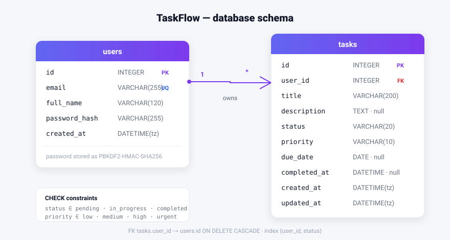

# TaskFlow ⚡ — Plan less. Ship more.

A full-stack, SaaS-style **task management system** built as a small but complete product:
JWT authentication, task CRUD with priorities & due dates, a kanban board, and a live
analytics dashboard — served by a FastAPI backend and a dependency-free SPA frontend.

**Live demo account:** `demo@taskflow.app` / `demo1234` (seeded with 14 realistic tasks)

---

## 1. Tech stack

| Layer     | Technology                                                        |
| --------- | ----------------------------------------------------------------- |
| Backend   | Python 3.13 · FastAPI · SQLAlchemy 2 (ORM) · PyJWT                 |
| Database  | SQLite (zero-config) — swap to PostgreSQL via one env var          |
| Auth      | PBKDF2-HMAC-SHA256 password hashing · HS256 JWT (7-day expiry)     |
| Frontend  | Vanilla ES-module SPA (no build step) · hand-rolled CSS design system |
| Serving   | Uvicorn serves the JSON API **and** the static frontend on one port |

## 2. Architecture

```
                    ┌──────────────────────────────────────────────┐
   Browser (SPA)    │                 FastAPI app                  │
  ┌──────────────┐  │  ┌────────────┐   ┌───────────┐  ┌────────┐  │
  │ #/login      │  │  │ auth.py    │   │ tasks.py  │  │ dash-  │  │
  │ #/ dashboard │──┼─▶│ /api/auth  │   │ /api/tasks│  │ board  │  │
  │ #/tasks      │  │  │ register   │   │ CRUD +    │  │ /api/  │  │
  │ #/board      │  │  │ login / me │   │ filters   │  │dashboard│ │
  └──────┬───────┘  │  └─────┬──────┘   └─────┬─────┘  └───┬────┘  │
         │ JWT in   │        └───────┬────────┴────────────┘       │
         │ header   │          ┌─────▼──────┐    ┌───────────────┐ │
         └──────────┼─────────▶│  deps.py   │───▶│  SQLAlchemy   │ │
                    │          │ JWT guard  │    │  models.py    │ │
                    │          └────────────┘    └──────┬────────┘ │
                    └───────────────────────────────────┼──────────┘
                                                        ▼
                                                 ┌─────────────┐
                                                 │ data/       │
                                                 │ taskflow.db │
                                                 └─────────────┘
```

## 3. Database design



**`users`**

| Column        | Type         | Constraints                     |
| ------------- | ------------ | ------------------------------- |
| `id`          | INTEGER      | PK, autoincrement               |
| `email`       | VARCHAR(255) | UNIQUE, indexed, lower-cased    |
| `full_name`   | VARCHAR(120) | NOT NULL                        |
| `password_hash` | VARCHAR(255) | NOT NULL (`pbkdf2_sha256$iter$salt$hash`) |
| `created_at`  | DATETIME(tz) | default now (UTC)               |

**`tasks`**

| Column        | Type         | Constraints                                    |
| ------------- | ------------ | ---------------------------------------------- |
| `id`          | INTEGER      | PK, autoincrement                              |
| `user_id`     | INTEGER      | FK → `users.id` ON DELETE CASCADE, indexed     |
| `title`       | VARCHAR(200) | NOT NULL                                       |
| `description` | TEXT         | nullable                                       |
| `status`      | VARCHAR(20)  | CHECK ∈ {pending, in_progress, completed}      |
| `priority`    | VARCHAR(10)  | CHECK ∈ {low, medium, high, urgent}            |
| `due_date`    | DATE         | nullable                                       |
| `completed_at`| DATETIME(tz) | nullable — business-rule managed (see §5)      |
| `created_at`  | DATETIME(tz) | default now                                    |
| `updated_at`  | DATETIME(tz) | default now, onupdate now                      |

Indexes: `users.email` (login), `ix_tasks_user_status (user_id, status)` (the hottest
query: "my tasks in column X"), `tasks.user_id` (FK lookups).

## 4. Authentication

```
POST /api/auth/register ──▶ hash password (PBKDF2) ──▶ insert user ──▶ issue JWT
POST /api/auth/login    ──▶ verify hash ─────────────▶ issue JWT
Every /api/tasks|dashboard request ──▶ Authorization: Bearer <jwt>
                                        │
                              deps.get_current_user
                              verify signature + exp + iss ──▶ load User ──▶ inject
```

- Tokens are **HS256 JWTs** carrying `sub` (user id), `email`, `iat`, `exp` (7 days), `iss`.
- Passwords are never stored or logged — only a salted PBKDF2 hash (120k iterations).
- Login on an unknown email runs a dummy hash comparison so **response timing doesn't
  leak** whether an address is registered.
- The frontend keeps the JWT in `localStorage`; a global 401 interceptor in
  `frontend/js/api.js` clears the session and redirects to `#/login`.

## 5. Business logic highlights

- **Ownership is the tenancy rule** — every task query is scoped by `user_id`; foreign
  tasks return `404` (not `403`, so existence isn't leaked).
- **Status transitions maintain `completed_at`**: moving a task *into* `completed`
  stamps the timestamp; moving it back out clears it. A task created directly as
  completed is stamped at creation. This single invariant powers the "completed this
  week" chart.
- **Overdue / due-today** are computed server-side: `due_date < today AND status != completed`.
- **Dashboard aggregation happens in SQL** (`GROUP BY status`, `GROUP BY priority`,
  `GROUP BY date(completed_at)`), not in Python loops, so it scales with task count.
- **Filtering & sorting**: status, priority, case-insensitive search over
  title+description, and 5 sort orders (incl. priority via a `CASE` expression and
  due-date with NULLs last).
- Validation everywhere: Pydantic enums for status/priority, length limits, email
  pattern, and DB-level `CHECK` constraints as a second line of defence.

## 6. API reference

Interactive docs at **`/docs`** (Swagger UI) while the server runs.

| Method | Route                       | Auth | Description                                     |
| ------ | --------------------------- | ---- | ----------------------------------------------- |
| POST   | `/api/auth/register`        | –    | Create account → `{access_token, user}` (201)   |
| POST   | `/api/auth/login`           | –    | Login → `{access_token, user}`                  |
| GET    | `/api/auth/me`              | ✔    | Current user profile                            |
| GET    | `/api/tasks`                | ✔    | List my tasks (`status`, `priority`, `q`, `sort`) |
| POST   | `/api/tasks`                | ✔    | Create task (201)                               |
| GET    | `/api/tasks/{id}`           | ✔    | Fetch one task                                  |
| PATCH  | `/api/tasks/{id}`           | ✔    | Partial update (incl. quick status moves)       |
| DELETE | `/api/tasks/{id}`           | ✔    | Delete task (204)                               |
| GET    | `/api/dashboard/summary`    | ✔    | Totals, completion rate, overdue, by-priority, weekly activity, recent tasks |
| GET    | `/api/health`               | –    | Liveness probe                                  |

## 7. Frontend

A hand-rolled, build-free SPA (`frontend/`) with a hash router and guard:

- **`#/login`, `#/register`** — split-screen marketing-style auth with one-click demo login
- **`#/`** — dashboard: stat cards, completion donut, weekly activity chart, priority
  breakdown, overdue banner, recent activity
- **`#/tasks`** — search, status chips, priority & sort filters; click the circle to
  cycle a task's status; edit/delete with confirm dialog
- **`#/board`** — drag-&-drop kanban (arrows provided for touch), same PATCH endpoint
- Fully **responsive**: sidebar becomes an off-canvas drawer, grids collapse, board
  stacks vertically under 900 px

```
frontend/
├── index.html
├── css/styles.css          # design tokens + full design system
└── js/
    ├── app.js              # shell + router + auth guard
    ├── api.js              # fetch wrapper, JWT attach, 401 interceptor
    ├── ui.js               # icons, toasts, modals, helpers
    ├── task-modal.js       # create/edit form (shared by all views)
    └── views/              # auth, dashboard, tasks, board
```

## 8. Run it

```bash
cd taskflow
pip install -r backend/requirements.txt
python -m uvicorn backend.app.main:app --host 0.0.0.0 --port 8000
```

…or simply `./run.sh`. Then open **http://localhost:8000** and sign in with
`demo@taskflow.app` / `demo1234` (or register your own account).

Environment variables (all optional):

| Variable                  | Default                          | Purpose                    |
| ------------------------- | -------------------------------- | -------------------------- |
| `TASKFLOW_SECRET`         | dev placeholder                  | JWT signing key            |
| `TASKFLOW_DATABASE_URL`   | `sqlite:///data/taskflow.db`     | e.g. a PostgreSQL URL      |

## 9. Production notes

- Set a strong `TASKFLOW_SECRET`; rotate it to invalidate all sessions.
- Point `TASKFLOW_DATABASE_URL` at PostgreSQL/MySQL — the ORM models need no changes.
- Put the app behind TLS (Caddy/nginx) and tighten `CORSMiddleware` to your domain.
- For scale: add refresh tokens, rate-limit `/api/auth/login`, and consider an Alembic
  migration history in place of `create_all()`.
